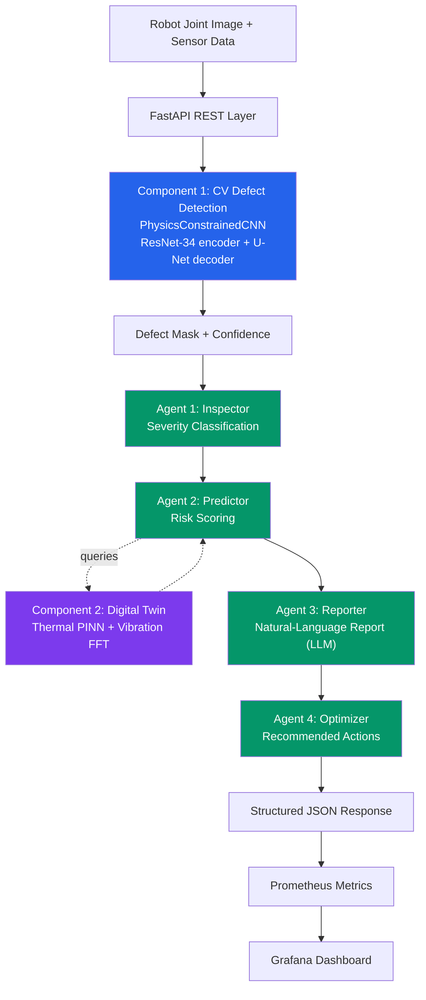
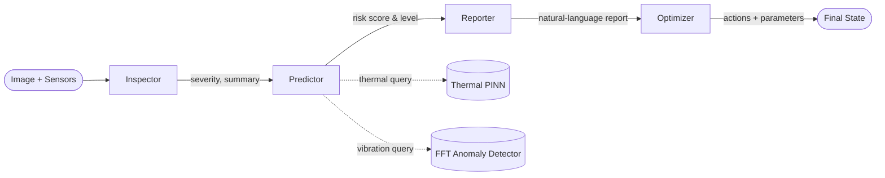
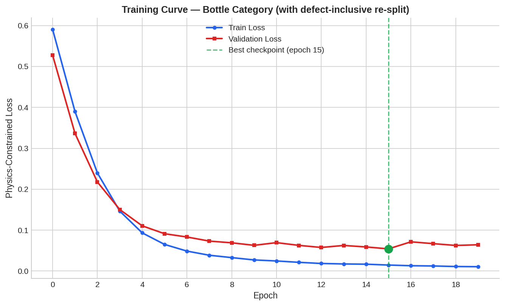
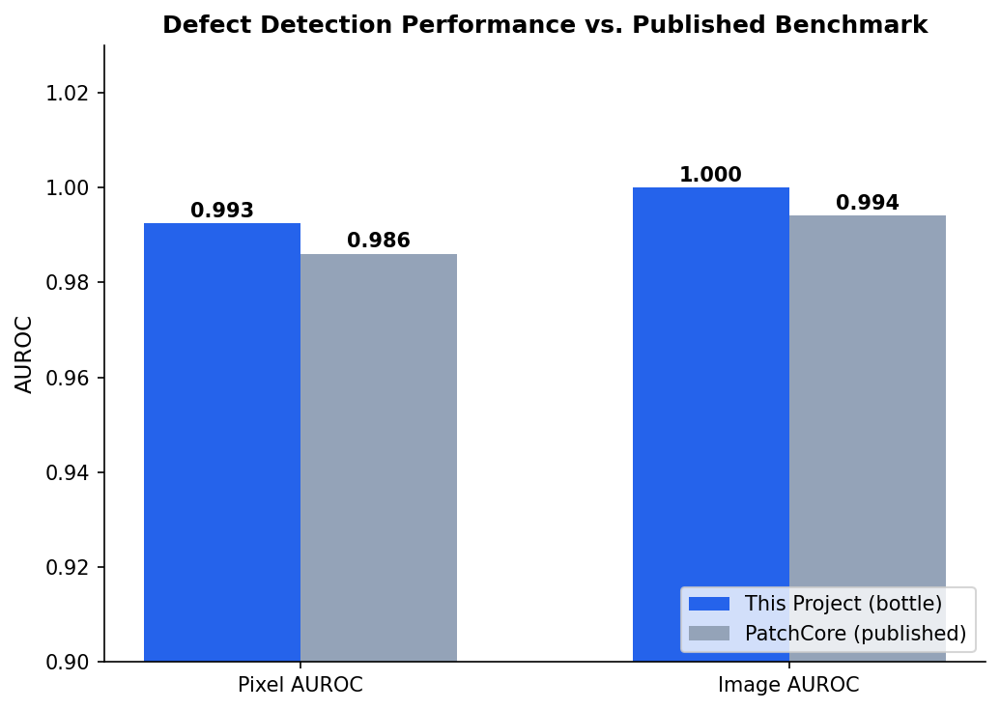
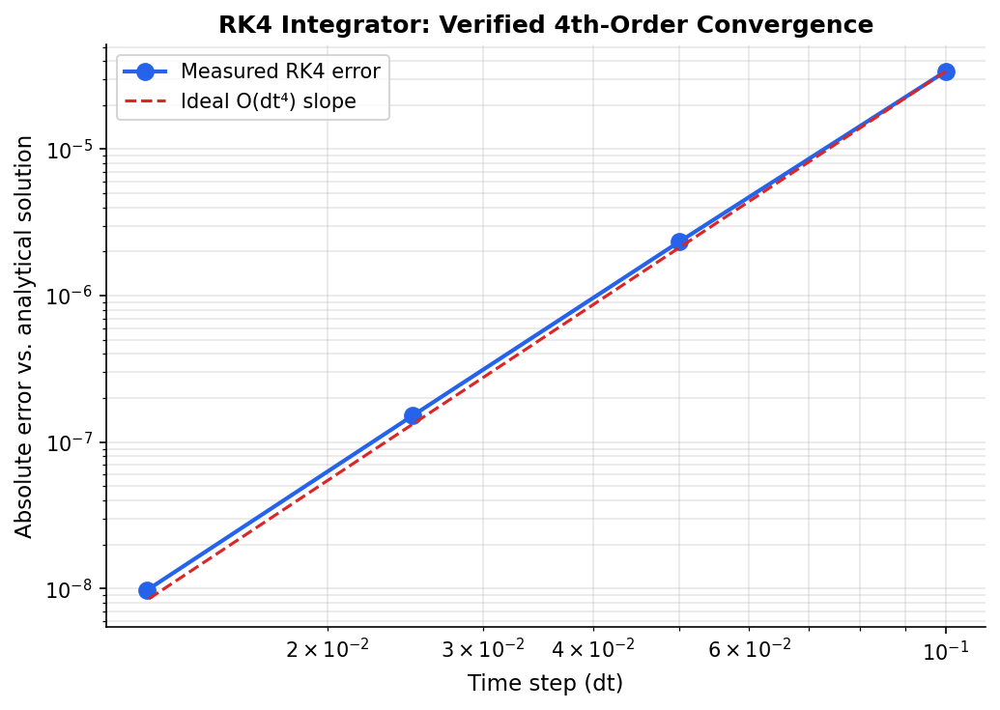

# Robot AI System — CV Quality Inspection, Digital Twin & Agentic Orchestration

A production-grade AI system for industrial robot joint inspection, combining three deeply integrated components — computer vision defect detection, physics-based digital twin simulation, and LLM-powered agentic decision-making — served as a monitored, containerized REST API.

---

## System Architecture



### Agent Pipeline Detail



---

## Repository Structure

```
robot-ai-system/
├── src/
│   ├── vision/          Component 1: CV defect detection
│   ├── digital_twin/    Component 2: kinematics, dynamics, thermal PINN, vibration FFT
│   ├── agents/          Component 3: LangGraph 4-agent pipeline
│   ├── integration/     Wires Components 1+2+3 together
│   ├── api/              FastAPI REST layer
│   └── monitoring/       Prometheus metrics + drift detection
├── tests/                 pytest suite (52 tests)
├── docker/                Dockerfile + docker-compose.yml
├── monitoring/            Prometheus/Grafana configs
├── .github/workflows/     CI pipeline
├── docs/images/           Generated charts (this README)
├── outputs/               Trained model checkpoints (not committed to git)
└── requirements.txt
```

---

## Tech Stack

| Category | Tools |
|---|---|
| **Language** | Python 3.13 |
| **Deep Learning** | PyTorch, torchvision |
| **Classical ML / Metrics** | scikit-learn, SciPy |
| **Computer Vision** | Pillow, custom CNN architecture (ResNet-34 encoder + U-Net decoder) |
| **Scientific Computing** | NumPy, SciPy (ODE integration, statistical tests, signal processing) |
| **LLM & Agents** | LangGraph, Hugging Face Transformers (`flan-t5-base`) |
| **Dataset Management** | FiftyOne, Hugging Face Hub |
| **API Framework** | FastAPI, Uvicorn, Pydantic |
| **Containerization** | Docker, Docker Compose |
| **Monitoring & Observability** | Prometheus, Grafana, `prometheus-client` |
| **Testing** | pytest |
| **CI/CD** | GitHub Actions |
| **Version Control** | Git |

---

## Quick Start

### Local development
```bash
python -m venv venv
venv\Scripts\activate          # Windows
pip install -r requirements.txt
```

### Train the CV model (Component 1)
```bash
python src/vision/inspect_hf_schema.py   # one-time: downloads MVTec AD via Hugging Face
python src/vision/train.py --category bottle --epochs 20
python src/vision/evaluate.py --category bottle
```

### Run the full system
```bash
# Directly with uvicorn:
python -m uvicorn src.api.main:app --host 0.0.0.0 --port 8000 --reload

# Or the full containerized stack (API + Prometheus + Grafana), single command:
docker compose -f docker/docker-compose.yml up --build
```
- API docs: http://localhost:8000/docs
- Prometheus: http://localhost:9090
- Grafana: http://localhost:3000 (`admin` / `admin`)

### Run tests
```bash
python -m pytest tests/ -v
```

---

## Component 1: Physics-Constrained CV Defect Detection

### Architecture
A U-Net-style encoder-decoder built on a **pretrained ResNet-34 encoder** (ImageNet weights; `stem` + `layer1` frozen, `layer2/3/4` fine-tuned), chosen after an initial from-scratch 51.7M-parameter encoder badly overfit on MVTec's ~200-image-per-category training sets.

### Novel loss function

$$\mathcal{L}_{total} = \mathcal{L}_{CE}(y, \hat y) + \lambda_1 \cdot \mathcal{L}_{topo}(\hat y) + \lambda_2 \cdot \mathcal{L}_{surf}(\hat y)$$

**Topology-aware loss** — a differentiable proxy for topological fragmentation using soft morphological opening (soft-erosion → soft-dilation via smooth min/max pooling), penalizing predictions scattered into many small disconnected regions rather than coherent defect blobs, without the cost of computing full persistent homology:

$$\mathcal{L}_{topo}(\hat y) = \left\| \hat y - \text{SoftOpen}(\hat y) \right\|_1$$

**Surface continuity loss** — a gradient-magnitude penalty on the predicted probability field, directly analogous to PDE boundary-smoothness terms:

$$\mathcal{L}_{surf}(\hat y) = \mathbb{E}\left[ \|\nabla \hat y\|_2 \right]$$

### Critical dataset design decision

MVTec AD's **official** train/test split contains *only normal images* in training, by design, for unsupervised anomaly detection. Training a supervised, mask-based segmentation model on that split produces a degenerate result — the network learns to always predict "no defect," since it never sees a single positive example during training. **This project uses a custom re-split**: 60% of labeled defective images (with real masks) are moved into training, the remainder held out for validation, enabling genuine supervised learning of defect boundaries. This is a deliberate deviation from the standard MVTec benchmark protocol, so results below are not a strict apples-to-apples comparison to published unsupervised methods.

### Training Results



### Evaluation Results (bottle category)



| Metric | Value |
|---|---|
| Pixel AUROC | 0.9925 |
| Image AUROC | 1.0000 |
| Pixel Precision | 0.84 |
| Pixel Recall | 0.75 |
| Pixel F1 | 0.79 |

---

## Component 2: Robot Digital Twin

### Kinematics
Standard Denavit-Hartenberg parametrization. Forward kinematics chains homogeneous transforms:

$$T_{0}^{n} = \prod_{i=1}^{n} T_{i-1}^{i}(\theta_i, d_i, a_i, \alpha_i)$$

Inverse kinematics via damped least-squares (Levenberg-Marquardt), with multi-start retries for robustness against local minima:

$$\Delta\theta = J^T(JJ^T + \lambda^2 I)^{-1} \, e$$

*Verified: Jacobian matches finite-difference derivatives to ~3×10⁻⁷; IK converges to sub-micron accuracy; 49/50 random configurations converge with multi-start retries.*

### Dynamics
Each joint modeled as a damped pendulum under gravity — a documented simplification of full coupled rigid-body dynamics, which would require per-link mass/inertia parameters not available without a specific robot's spec sheet:

$$I_i \ddot\theta_i + b_i \dot\theta_i + c_i \sin\theta_i = \tau_i(t)$$

Integrated via a general-purpose 4th-order Runge-Kutta solver.



*Cross-validated against `scipy.integrate.solve_ivp` (0 rad difference); confirmed physically correct energy dissipation under damping.*

### Thermal PINN
1D heat conduction with internal heat generation (motor/friction losses) and a Robin (convective) boundary condition:

$$\frac{\partial T}{\partial t} = \alpha \frac{\partial^2 T}{\partial x^2} + \frac{q}{\rho c_p}, \qquad -k\left.\frac{\partial T}{\partial x}\right|_{x=L} = h(T - T_{amb})$$

Validated against a closed-form analytical steady-state solution:

$$T_{ss}(x) = T_{amb} + \frac{qL}{h} + \frac{q}{2k}(L^2 - x^2)$$

**Engineering note:** the first training attempt used aluminum-like conductivity, creating a ~2000× separation between the internal-diffusion and convective-equilibration timescales — a numerically stiff problem where the PDE loss barely penalized ignoring the heat source term. Switching to a composite-housing material (Biot number ≈ 0.5) and non-dimensionalizing the PDE residual by the source term's own scale fixed this. Final result: **8.24% relative error** against the analytical solution, cross-validated against an independent Crank-Nicolson finite-difference solver.

### Vibration Anomaly Detection
FFT-based spectral comparison (Hann-windowed, band-averaged for statistical robustness) between a healthy baseline and live signal, flagging new spectral energy at fault-characteristic frequencies — the same principle used in real industrial vibration monitoring.

*Verified: peak-frequency detection within theoretical frequency resolution; zero false positives on healthy-vs-healthy and pure-noise comparisons; correctly localizes injected fault frequencies.*

---

## Component 3: Agentic Orchestration (LangGraph)

Four agents run in sequence, sharing a single `InspectionState`:

| Agent | Role | Approach |
|---|---|---|
| **Inspector** | Severity classification from CV output | Rule-based, with low-confidence downgrading |
| **Predictor** | Failure risk scoring | Queries digital twin (thermal + vibration), explainable weighted combination |
| **Reporter** | Natural-language report generation | `flan-t5-base` (Hugging Face), deterministic template fallback |
| **Optimizer** | Actionable recommendations | Rule-based for auditability — parameter adjustments + prioritized actions |

---

## Production Infrastructure

- **REST API** (FastAPI): `/inspect` (multipart image upload + sensor telemetry → full structured result), `/health`, `/metrics`
- **Docker**: single `docker-compose up` deploys the API + Prometheus + Grafana together
- **Monitoring**: request/latency/error metrics, model confidence distribution, KS-test-based drift detection
- **CI**: GitHub Actions runs the full test suite + Docker build verification on every push
- **Tests**: 52 tests across CV, digital twin, agents, and API layers, running in ~9 seconds (network-dependent paths like PINN training and live LLM calls are intentionally excluded from the fast suite, validated separately during development)

---

## Known Limitations

- CV model currently trained on the `bottle` category only; other MVTec categories need separate training runs (`train.py --category <name>`)
- The custom train/test re-split means benchmark comparisons to published MVTec numbers aren't strictly apples-to-apples
- Digital twin's dynamics model uses decoupled per-joint pendulum dynamics, not full coupled rigid-body dynamics
- Reporter's LLM path requires internet access to Hugging Face on first run (falls back to template gracefully if unavailable)